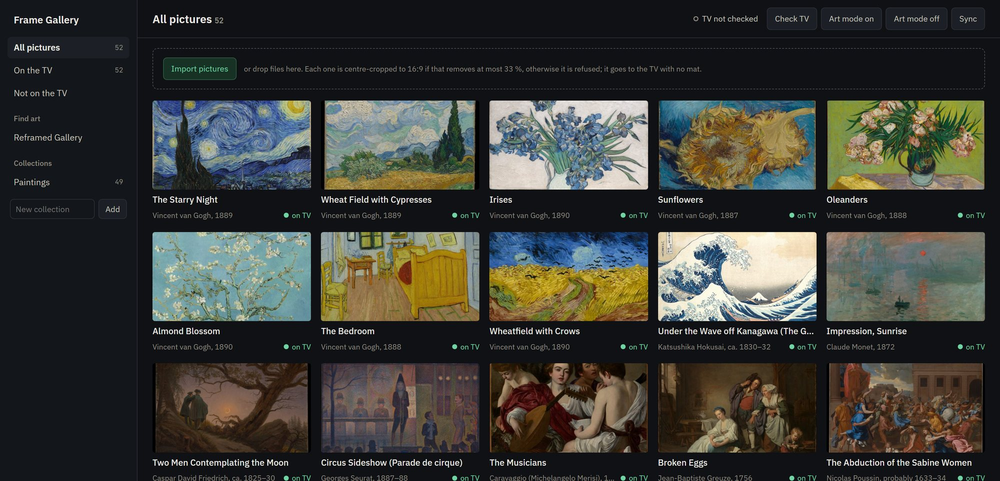
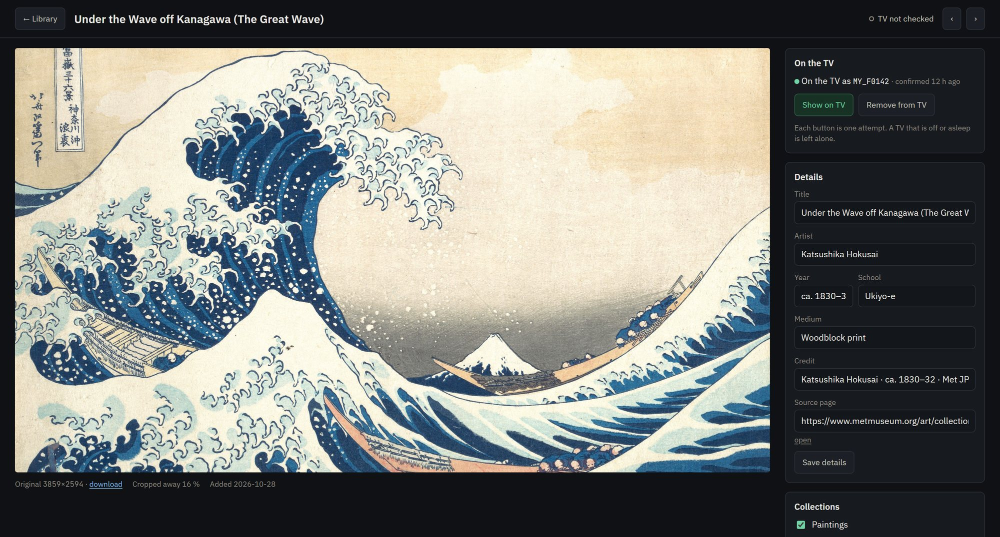

# Frame Gallery

<p align="center">
  <b>A local picture library for the Samsung The Frame.</b><br/>
  Your pictures live on your server. The TV only hears from it when you press a button.
</p>

<p align="center">
  <a href="https://github.com/Filip-Pajalic/frame-gallery/actions/workflows/ci.yml"></a>
  
  
  
  
  
</p>

<p align="center">
  <a href="#quick-start">Quick start</a> ·
  <a href="#what-it-does">What it does</a> ·
  <a href="#how-it-treats-the-tv">How it treats the TV</a> ·
  <a href="#running-it-on-a-server">Running it on a server</a> ·
  <a href="#the-protocol">The protocol</a> ·
  <a href="#thanks">Thanks</a> ·
  <a href="./LICENSE">License</a>
</p>

---

Frame Gallery keeps your art the way a photo library does: originals, a
3840×2160 version fitted for the screen, and thumbnails on disk, with titles,
artists and collections in one SQLite file. Browsing it never touches the TV.
When you press **Show on TV**, it opens one connection to the Frame, uploads the
picture if the TV does not have it yet, shows it, and closes the connection.

<p align="center">
  
</p>

<p align="center">
  <sub>The library. Every thumbnail comes from the server's own disk; the green
  dot says the TV holds that picture, as of the last upload or Sync.</sub>
</p>

<p align="center">
  
</p>

<p align="center">
  <sub>One picture: the fitted version, how much the crop took, where it came
  from, and the two buttons that talk to the TV.</sub>
</p>

## Quick start

Needs [Go](https://go.dev) 1.27 or later. There is no other dependency: the
SQLite driver is pure Go, and the templates, styles and fonts are embedded.

```bash
git clone https://github.com/Filip-Pajalic/frame-gallery
cd frame-gallery
FRAME_TV=192.168.1.50 go run ./cmd/frame -data ./data
```

Open <http://localhost:18000>. Use your TV's address, which you'll find under
**Settings › General › Network › Network Status**. The first time Frame Gallery
reaches the TV, the TV asks whether to allow it.

Import a folder of pictures, with or without a manifest:

```bash
go run ./cmd/frame -data ./data import a.jpg b.png
go run ./cmd/frame -data ./data import -collection "Paintings" manifest.json
```

A manifest is a JSON list of `{file, title, artist, year, school, medium,
source, url, tv_content_id}`, with files relative to the manifest.

Check the TV by hand, one call at a time:

```bash
go run ./cmd/frame tv status      # API version, art mode, what is on screen
go run ./cmd/frame tv list        # everything in the TV's art store
```

## What it does

**A library that fits the screen.** An import is centre-cropped to 16:9 when
that removes at most a third of the picture, and refused, with the reason,
when it would remove more. The limit is `FRAME_MAX_LOSS`. Every picture goes to
the TV at 3840×2160 with no mat, so it fills the screen edge to edge. Phone
photos are turned upright from their EXIF orientation first.

**The TV, on request.** Show on TV, upload, remove from the TV, art mode on or
off, and **Sync**: one request for the TV's content list, which marks the
library pictures the TV holds and counts the uploads the library does not know.

**Collections.** Group pictures however you like; an import can land straight
in one.

**Art to find.** The Browse page reads [Reframed Gallery](https://www.reframed.gallery/),
a free collection of fine art already reframed to 3840×2160 for TVs. It opens on
collections for the time of year, lists all of them, and searches artists and
titles. **Import** copies one picture into your library, credited to the site
with a link back. Nothing is fetched until someone opens the page, and nothing
is crawled.

**A quiet interface.** Dark by default, light when your system is, the same
page on a phone. IBM Plex Sans for words, JetBrains Mono for ids and numbers.

## How it treats the TV

A Frame on Wi-Fi spends most of its life asleep, and a program that keeps
trying to reach it will eventually wake it. Frame Gallery is built so that it
cannot:

- **No Wake-on-LAN.** There is no magic packet in the code, and no MAC address
  anywhere.
- **No background contact.** No polling, no keep-alive, no retries, no start-up
  check. The server can run for months without the TV hearing from it.
- **One attempt per button.** A press opens one connection, with a 4-second
  limit to reach the TV. If the TV is off, asleep or off Wi-Fi, the page says
  *TV not reachable*, and that is the end of it.
- **One action at a time.** A second press while the first is running is told
  so instead of queued.

What the TV sends back is parsed into typed replies and refused when it does
not fit. A reply over 4 MB, an id that cannot be a content id, or a missing
field is an error, never a guess.

## Running it on a server

The repository builds a container from scratch: the binary, a CA bundle for the
Browse page, and nothing else.

```bash
docker build -t frame-gallery:local .
docker run -d --name frame-gallery -p 18000:18000 \
  -e FRAME_TV=192.168.1.50 \
  -v /srv/frame-gallery:/data \
  frame-gallery:local
```

It runs as `99:100` with a health check of its own (`/frame health`). Bridge
networking is enough: nothing needs to reach the TV's network segment by
broadcast.

**Unraid.** [`unraid/my-FrameGallery.xml`](./unraid/my-FrameGallery.xml) is a
Docker template. Build the image on the server, copy the template to
`/boot/config/plugins/dockerMan/templates-user/`, and add the container from
the Docker tab. Set the TV address there.

| Setting | Default | |
|---|---|---|
| `FRAME_TV` | none | The TV's address. Required for anything that talks to the TV |
| `FRAME_DATA` | `data` (`/data` in the image) | The library: `library.db`, `originals/`, `fitted/`, `thumbs/`, the TV token |
| `FRAME_HTTP` | `:18000` | Listen address |
| `FRAME_MAX_LOSS` | `0.33` | The largest share of a picture the 16:9 crop may remove |

## The protocol

This is the Frame's art-app protocol as Frame Gallery speaks it, measured on a
2022 Frame (QE55LS03B, art API 4.3.4.0):

- `ws://TV:8001/api/v2/channels/com.samsung.art-app?name=<base64 name>`
  answers `ms.channel.connect`, which may carry a token, then
  `ms.channel.ready`.
- A request is an `ms.channel.emit` of `art_app_request` with a JSON string in
  `data`. Replies are `d2d_service_message` events matched on `request_id`.
- An upload is `send_image` with matte `none`, and `conn_info` must carry
  `request_id`, because this TV does not answer a `connection_id`. The TV
  replies `ready_to_use` with a socket address. The picture goes over TLS: a
  4-byte big-endian header length, a JSON header with the `secKey`, then the
  bytes. `image_added` names the new content id.
- The TV refuses matte `none` on anything taller than 16:9. The full-screen
  rule never sends it one.

`pkg/tv/tv_test.go` runs all of it against a fake TV, upload socket included.

## Repository shape

```
cmd/frame/          the binary: serve, import, tv, health
pkg/tv/             the Samsung Frame art-app protocol, usable on its own
pkg/reframed/       a reader for reframed.gallery's public pages
internal/library/   the SQLite library, the full-screen rule, thumbnails
internal/web/       the pages, the JSON API, embedded templates and assets
unraid/             the Unraid Docker template
```

`go vet ./...`, `gofmt`, `staticcheck` and `govulncheck` are clean, and CI runs
the first three with the tests on every push.

## Thanks

Frame Gallery is inspired by **[Docent](https://github.com/danmunz/docent)** by
Dan Munz (MIT). The idea of a personal gallery manager for the Frame that runs
on your own network, with uploads, mattes and collections of art you choose,
comes from Docent. Frame Gallery is a separate program written from scratch in
Go, and it makes one different trade-off: it never wakes the TV, which matters
on a TV that sleeps on Wi-Fi. Thank you, Dan, for showing how good this can be.

It also stands on:

- **[samsung-tv-ws-api](https://github.com/xchwarze/samsung-tv-ws-api)**
  (`samsungtvws`, LGPL-3.0) by DSR! and Matthew Garrett. Its art module
  documents the art-app protocol. No code is copied from it; the Go client was
  written against its behaviour and against what the TV does.
- **[Reframed Gallery](https://www.reframed.gallery/)**: the free collection
  behind the Browse page. The pictures are theirs to curate. Please
  [support them](https://ko-fi.com/O5O51FWPUL) if you use it.
- **[The Metropolitan Museum of Art Open Access](https://www.metmuseum.org/about-the-met/policies-and-documents/open-access)**
  and **[Wikimedia Commons](https://commons.wikimedia.org/)** for the
  public-domain paintings in the screenshots.
- **[gorilla/websocket](https://github.com/gorilla/websocket)** (BSD-2-Clause),
  **[modernc.org/sqlite](https://gitlab.com/cznic/sqlite)** (BSD-3-Clause) and
  **[golang.org/x/image](https://pkg.go.dev/golang.org/x/image)**
  (BSD-3-Clause).
- **[IBM Plex Sans](https://github.com/IBM/plex)** and
  **[JetBrains Mono](https://github.com/JetBrains/JetBrainsMono)**, both under
  the SIL Open Font License 1.1. Their licences are in
  [`internal/web/static/fonts/`](./internal/web/static/fonts/).

Samsung, The Frame and Tizen are trademarks of Samsung Electronics. This project
is not affiliated with or endorsed by Samsung.

## Status

Used daily on one 2022 Frame. Other models and firmware may answer
differently. If yours does, please open an issue with what `frame tv status`
and `frame tv list` print.

## License

MIT. See [`LICENSE`](./LICENSE).
